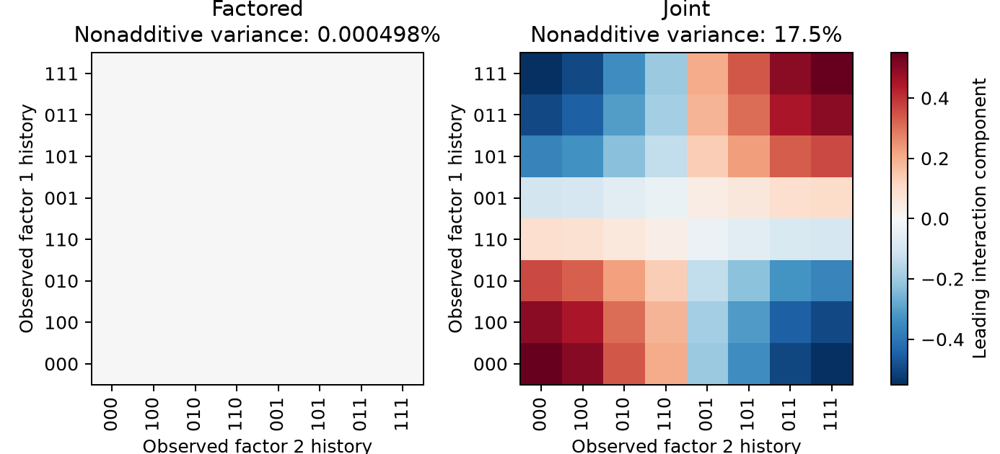
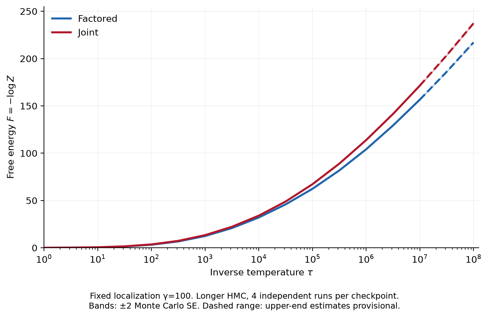

# Factored representations and localized free energy

Can equally accurate predictors have different volumes of low-loss parameters
around their trained solutions? Does this volume favor representations that
separate independent factors? Can a redundant joint representation persist
when prediction no longer requires it?

This repository studies these questions in a **628-parameter transformer**
predicting observations from two independent binary hidden Markov chains.
Temporary auxiliary losses prepare predominantly factored and joint hidden
features from the same initialization. We then remove the auxiliary losses,
optimize prediction alone, probe the resulting representations, and estimate
their localized free energies using annealed sequential Monte Carlo (SMC)
with Hamiltonian Monte Carlo (HMC) moves.

The prepared joint features persist under the tested prediction-only dynamics.
For the seed-zero pair, the factored checkpoint has lower localized free energy
throughout the tested range. **The free-energy slopes have not converged to a
plateau, so these results do not establish different asymptotic local learning
coefficients (LLCs).**

## Prediction problem and preparation

The latent chains have state-persistence probabilities 0.88 and 0.78 and
observation accuracies 0.90 and 0.85. Each observation pair is mapped to one
of four tokens, with permuted labels. The model predicts the next token from
three preceding tokens. All **64 contexts** are enumerated, with exact context
probabilities and soft prediction targets. Training minimizes population KL;
there is no finite training sample or minibatch gradient noise.

The transformer has one attention block, two heads, residual width 8, a GELU
MLP of width 16, and an unrestricted affine readout. It has no layer
normalization or dropout. All 628 parameters remain free.

For each of three paired initialization seeds, a temporary activation penalty
encourages one of two codes:

- **Factored:** the two posterior marginal moments and two predictive logit
  contrasts, each depending on one factor's observation history.
- **Joint:** these four features plus the posterior product moment. The two
  marginal moments and product moment determine all four posterior joint-state
  probabilities by a linear map.

Both target codes have centered variance one and use the same random
orthogonal embedding in the eight-dimensional hidden space. The auxiliary
coefficient is 0.3 during preparation and is annealed to zero. Subsequent Adam,
L-BFGS, and numerical refinement use prediction alone. The source factors are
independent, so the product feature is predictively redundant. The question is
whether it remains prominent after supervision ends.

## Representation probes and persistence

We regress the final hidden activations on sums of arbitrary functions of
the two observed factor histories. The remaining fraction of activation
variance measures **nonadditivity**. Weighted linear probes also measure how
well activations recover each posterior marginal moment and the product
moment. These probes are fitted and evaluated on the complete population
context table; their scores describe representability, rather than held-out
probe generalization.

| Training seed | Factored nonadditive variance | Joint nonadditive variance | Joint product-moment probe R² |
|---|---:|---:|---:|
| 0 | 0.000498% | 17.485% | 0.999879 |
| 1 | 0.001777% | 11.054% | 0.999486 |
| 2 | 0.000423% | 15.113% | 0.999755 |

All six final fits have population KL between approximately
$3.5\times10^{-12}$ and $4.0\times10^{-11}$. In the pair used for SMC,
KL is $9.3192\times10^{-12}$ for the factored checkpoint and
$1.8240\times10^{-11}$ for the joint checkpoint.



All six prepared checkpoints retain their original representation class over
**20,000 additional prediction-only GD steps**, with learning rate 0.2 and
all parameters updated. The seed-zero joint nonadditive variance changes from
17.4851167% to 17.4851256%. Four perturbation trials at each coordinate standard
deviation 0.01, 0.03, and 0.10 also retain the seed-zero joint class after
20,000 steps. These are finite-time local persistence observations.

Raw variance fractions depend on the hidden-coordinate basis. Exact
prediction-preserving basis changes can alter them, and weak joint information
is also linearly accessible in the factored checkpoints. The analysis includes
whitened nonadditivity and affine reconstruction controls. Thus, “factored” and
“joint” describe feature prominence; they do not imply that one representation
contains no joint information. See [methods and interpretation](./docs/METHODS.md).

## Localized free energy

Let $K(w)$ be the context-weighted population prediction KL and $w_{\ast}$ a
saved checkpoint. We use the same localization precision $\gamma=100$
for both arms:

$$
p_0(w)=\mathcal{N}(w_{\ast},I/100),
\qquad
F(\tau)=-\log\mathbb{E}_{p_0}\left[\exp\left(-\tau[K(w)-K(w_{\ast})]\right)\right].
$$

The normalized Gaussian fixes $F(0)=0$. Its coordinate standard deviation
is 0.1; $\tau$ changes the preference for low prediction loss while the
localization remains fixed. Lower free energy means greater Gaussian-weighted
low-loss parameter volume in these weight coordinates.

A discarded pilot chooses intermediate temperatures and HMC step sizes.
Production populations use the frozen schedule, independent Gaussian prior
draws, systematic resampling, and Metropolis-corrected HMC. The loss remains
the full nonlinear transformer loss. Fisher preconditioning changes proposals;
it does not replace the objective or restrict the parameter space.



The primary estimates use four independent 128-particle populations per arm,
with longer HMC trajectories from $\tau=10^6$ onward. Parentheses give one
Monte Carlo standard error across complete populations.

| Inverse temperature | Factored free energy | Joint free energy |
|---|---:|---:|
| 10,000 | 32.04 (0.13) | 34.00 (0.11) |
| 100,000 | 62.36 (0.18) | 67.21 (0.11) |
| 1,000,000 | 104.12 (0.25) | 113.87 (0.25) |
| 10,000,000 | 156.65 (0.33) | 171.43 (0.28) |
| 100,000,000, provisional | 217.07 (0.16) | 237.27 (0.31) |

Particle-count and HMC-effort checks broadly agree through $10^7$. At
$10^8$, sampling is more sensitive and the estimates remain provisional.
Increasing finite-window slopes prevent identifying the observed gap with
a difference in asymptotic LLCs. SMC uses one training pair; independent SMC
populations quantify integration variability, not variation across training
initializations.

Writing the loss-weighted distribution as $\pi_\tau$, the exact decomposition is

$$
F(\tau)=\tau\mathbb{E}_{\pi_\tau}[K(w)-K(w_{\ast})]
+D_{\mathrm{KL}}(\pi_\tau\Vert p_0).
$$

The concentration term accounts for about 75% of the free-energy gap at
$10^6$ and 85% at $10^7$. This is a property of the localized parameter
distributions. It does not determine optimizer basin probabilities or the
frequency of either representation under SGD.

## Reproduce and inspect

Use Python 3.12 and the packages in [requirements.txt](./requirements.txt).
In an environment where these dependencies are available, run from the
repository root:

```sh
python -m unittest discover -s tests -v
python verify_results.py
python analyze_paired.py
python analyze_smc.py
```

The verification script checks distributed asset hashes, recomputes all six
checkpoint probes and losses, reproduces 255 free-energy curve points from
96 saved production populations, and checks the recorded persistence histories.
The analysis scripts regenerate the tables and figures from saved records.
No model training or new SMC integration is needed for these commands.

Train fresh paired checkpoints and rerun persistence with:

```sh
python paired_experiment.py --stage train --seeds 0 1 2 --output runs/paired
python persistence.py --results runs/paired --output runs/persistence
```

For the exact production settings, pilot schedules, random seeds, toy
calibrations, and commands to rerun SMC, see
[the reproduction guide](./docs/REPRODUCING.md). Fresh outputs belong in
`runs/`; the distributed checkpoints and records remain the reference data.

## Repository contents

| File or directory | Purpose |
|---|---|
| [experiment.py](./experiment.py) | Exact source distributions, transformer, stable KL, probes, and MCMC kernels |
| [paired_experiment.py](./paired_experiment.py) | Matched preparation, prediction-only refinement, and optional standalone MCMC |
| [problems.py](./problems.py) | Frozen-dataset validation, checkpoint loading, and exact toy integrals |
| [smc.py](./smc.py) | Pilot and production SMC with resumable HMC populations |
| [analyze_paired.py](./analyze_paired.py) | Activation geometry, coordinate controls, and matched MCMC summaries |
| [analyze_smc.py](./analyze_smc.py) | Evidence pooling, uncertainties, decomposition, slopes, and figures |
| [persistence.py](./persistence.py) | Unforced GD continuation and optional initial perturbations |
| [tests/](./tests/) | Scientific controls, numerical regression checks, and workflow tests |
| [results_paired/](./results_paired/) | Frozen data, six final checkpoints and their regularized precursors, probes, MCMC summaries, and GD histories |
| [results_smc/](./results_smc/) | Pilot schedules, raw stage records, aggregated results, and figures |
| [provenance/](./provenance/) | Original and distributed asset hashes, reference curves, and extraction notes |

The repository contains the paired-representation and localized-free-energy
experiments, together with their local persistence checks. Later basin-search,
variational, and noisy-trajectory studies are separate experiments.

The SMC method follows [Dai et al., *An invitation to sequential Monte Carlo
samplers*](https://arxiv.org/abs/2007.11936). For the asymptotic free-energy
framework motivating LLCs, see [Watanabe, *A Widely Applicable Bayesian
Information Criterion*](https://www.jmlr.org/papers/v14/watanabe13a.html).
