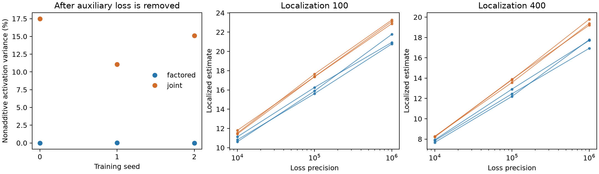
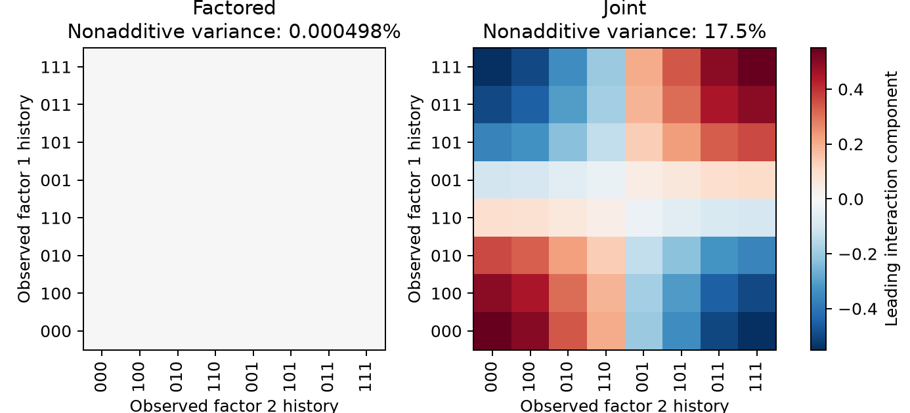

# Matched same-data results

Only configurations with usable sampling diagnostics in both arms enter these comparisons.
Values are finite-precision localized estimates, not established asymptotic LLCs.

Each curve is one training seed; error bars are Monte Carlo standard errors. Only matched usable configurations are plotted.

The following seed-zero plot shows the leading activation component left after fitting additive factor contributions, on a common color scale.

| Precision | Localization | Matched training seeds | Factored mean | Joint mean | Mean joint minus factored | SD of paired differences |
|---|---:|---:|---:|---:|---:|---:|
| 1e+04 | 100 | 3 | 10.853 | 11.583 | 0.730 | 0.302 |
| 1e+04 | 400 | 3 | 7.818 | 8.246 | 0.428 | 0.150 |
| 1e+05 | 100 | 3 | 15.923 | 17.463 | 1.541 | 0.185 |
| 1e+05 | 400 | 3 | 12.527 | 13.766 | 1.239 | 0.278 |
| 1e+06 | 100 | 3 | 21.156 | 23.079 | 1.923 | 0.527 |
| 1e+06 | 400 | 3 | 17.471 | 19.455 | 1.984 | 0.350 |

The standard deviation is across paired training seeds, not Monte Carlo error.
Individual estimates and Monte Carlo errors are in matched_comparisons.csv.

## Activation-coordinate controls

The raw variance screen measures dominant geometry and is sensitive to coordinate scaling.
Weak joint features may be present in the factored arm. The following whitened diagnostic
is invariant to invertible affine activation transformations at numerical rank cutoff 1e-12.

| Seed | Factored whitened nonadditivity | Joint whitened nonadditivity | Joint-code affine reconstruction error from factored code |
|---|---:|---:|---:|
| 0 | 0.1684 | 0.2897 | 0.001515 |
| 1 | 0.2156 | 0.2321 | 0.02469 |
| 2 | 0.2103 | 0.2090 | 0.004667 |

These controls prevent a change in the prominence of weak features from being interpreted
as proof that one code lacks joint information. They do not by themselves classify the LLC.

## Representation within sampled neighborhoods

Only usable runs with retained-state observations are shown. Quantiles describe the observed states and are not confidence intervals.

| Seed | Arm | Precision | Localization | Mean nonadditive variance (%) | 5%–95% range (%) |
|---|---|---:|---:|---:|---:|
| 0 | factored | 1e+06 | 100 | 0.202 | 0.030–0.574 |
| 0 | joint | 1e+06 | 100 | 14.122 | 8.819–20.323 |
| 2 | factored | 1e+05 | 100 | 0.428 | 0.128–0.961 |
| 2 | joint | 1e+05 | 100 | 11.461 | 6.025–17.275 |
| 2 | factored | 1e+06 | 100 | 0.184 | 0.034–0.524 |
| 2 | joint | 1e+06 | 100 | 11.120 | 6.766–15.574 |
| 2 | factored | 1e+06 | 400 | 0.082 | 0.015–0.237 |
| 2 | joint | 1e+06 | 400 | 14.046 | 10.603–17.415 |
